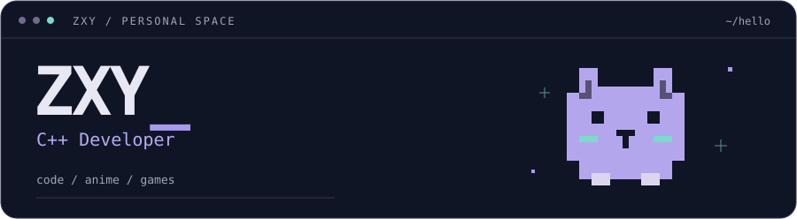

<p align="center">
  
</p>

<p align="center">
  <samp><a href="#about">/ about</a> &nbsp;·&nbsp; <a href="#stack">/ stack</a> &nbsp;·&nbsp; <a href="#now">/ now</a></samp>
</p>

<p align="center">
  <samp>「まだ、開発途中。」</samp><br>
  <sub>代码在迭代，我也是。</sub>
</p>

### About

一个喜欢折腾软件、工具和新技术的普通开发者。

Building things, learning things, occasionally breaking things.

```cpp
while (curious) {
    learn();
    build();
    play();
}
```

### Stack

`C++` &nbsp; `Linux` &nbsp; `Windows` &nbsp; `CMake` &nbsp; `Git`

### Now

- **Exploring** — 网络编程、开发工具与 AI 辅助开发
- **Off-screen** — Anime · Games · Music

---

<p align="center">
  <sub>Stay curious. Keep building. &nbsp; / &nbsp; <a href="https://github.com/GanYv123">@GanYv123</a></sub>
</p>
